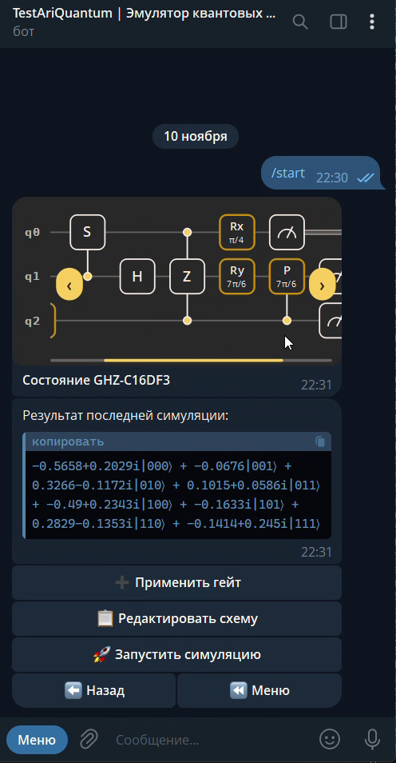
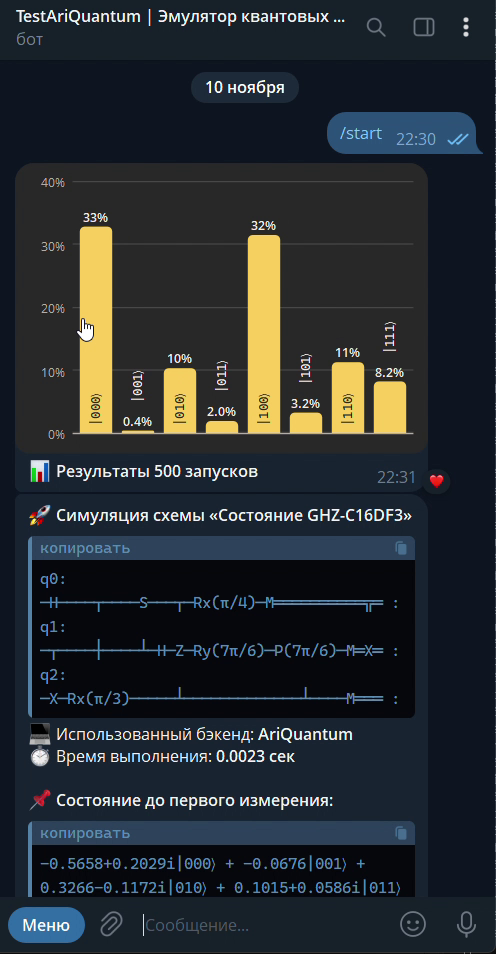
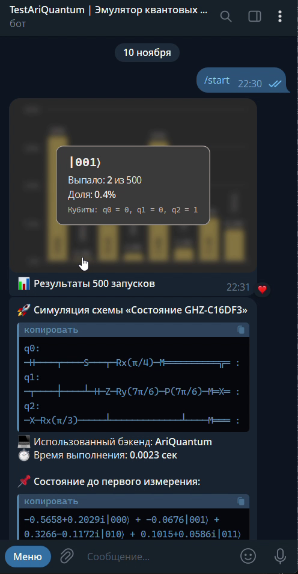
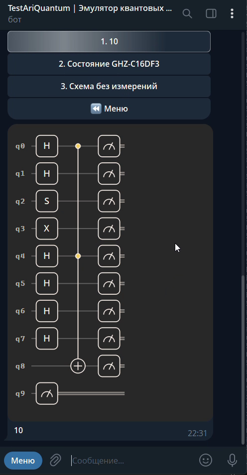
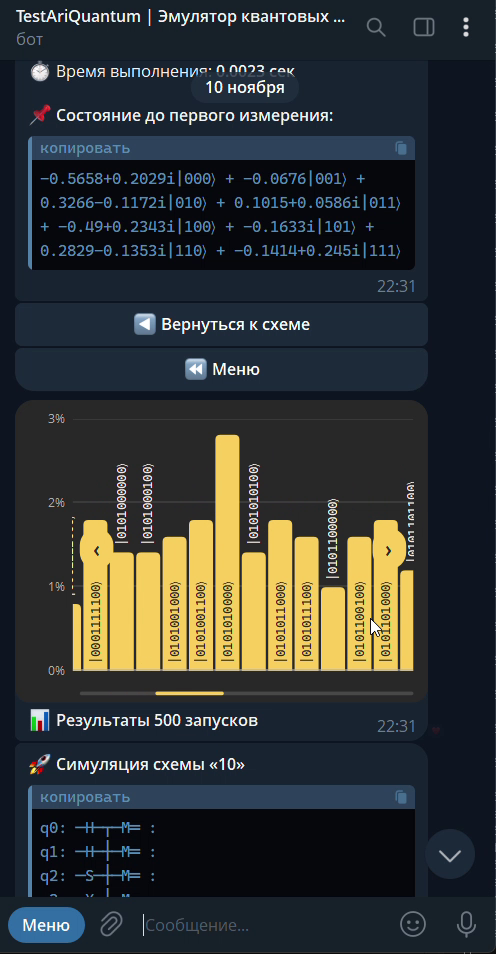

# AriQuantum Bot

A Telegram bot that emulates quantum computing: build quantum circuits gate by gate, run simulations, and look at the results as native Telegram HTML widgets.

The bot is powered by [**ariquantum**](https://github.com/ariquantum/ariquantum), our own Python library for quantum circuit simulation, and can also run circuits on **Qiskit Aer**.

<p align="center">
  
  
  
</p>

## Features

- **Circuit builder** with 1–10 qubits, up to 5 saved circuits per user. Everything is done with inline buttons, no commands to memorize.
- **Gates:** `I X Y Z H S T`, parametric `P Rx Ry Rz` (with angles such as π/2, 3π/4), controlled `CX CY CZ CH CS CP CRx CRy CRz`, Toffoli-style `CCX CCZ`, and measurements.
- **Two simulation backends:**
  - **AriQuantum** — our own emulator, fast on small circuits (up to 6 qubits).
  - **Qiskit Aer** — used automatically for larger circuits (up to 10 qubits).
- **Results:** state vector in Dirac notation before the first measurement plus measurement statistics for the chosen number of shots (up to 1000).
- **Circuit templates:** Bell state, GHZ state, superdense coding, quantum teleportation, CHSH test. Create your own circuit from a template in one tap.
- **Export:** OpenQASM 2.0, OpenQASM 3.0, and ready-to-run Python code for AriQuantum or Qiskit.
- **Editing:** delete any single gate or all measurements, clear, rename, or delete a circuit.
- **Three difficulty levels** (Novice / Student / Researcher) that change how detailed the hints are.
- **Languages:** English and Russian.
- **Admin panel:** user statistics, activity by day, circuits and backends statistics, user search and blocking, broadcast messages in two languages.

## HTML widgets (Bot API 10.4)

Circuits and measurement histograms are rendered as native Telegram [HTML widgets](https://core.telegram.org/bots/widgets) in the brand colors, in both light and dark themes.

- **Circuit widget:** gates are packed into columns the way they are executed, controls and targets are connected, classical wires are doubled after measurement. Long circuits scroll horizontally (swipe or ‹ › buttons).
- **Histogram widget:** only outcomes that actually occurred are shown, state labels are drawn right on the bars. With many outcomes (for example, 10 qubits) the chart switches to a scrolling mode and shows **all** of them. Tap a bar for details: count, share and the value of each qubit.
- **Settings:** each user can switch between *HTML widget* (default) and *ASCII text* output.
- Widgets currently work only in **private chats**. If a widget cannot be sent, the bot falls back to ASCII automatically.

`aiogram` 3.31 does not support `sendWidget` yet, so the bot calls it directly through a small custom method (`app/bot/utils/widgets.py`).

<p align="center">
  
  
</p>

## Tech stack

- Python 3.13
- [aiogram](https://github.com/aiogram/aiogram) 3 — Telegram Bot API framework
- PostgreSQL, SQLAlchemy 2 (async, asyncpg), Alembic
- [fluentogram](https://github.com/Aiogram-Dev/fluentogram) — Fluent-based localization (EN / RU)
- [ariquantum](https://github.com/ariquantum/ariquantum) and [Qiskit](https://github.com/Qiskit/qiskit) + Qiskit Aer — simulation

## Getting started

### 1. Install

```bash
git clone <this-repo-url>
cd AriQuantumBot
python -m venv .venv
.venv\Scripts\activate        # Linux/macOS: source .venv/bin/activate
pip install -r requirements.txt
```

### 2. Configure

Copy `.env.example` to `.env` and fill it in:

| Variable | Description |
| --- | --- |
| `BOT_TOKEN` | Token from [@BotFather](https://t.me/BotFather) |
| `ADMIN_IDS` | Comma-separated Telegram IDs of admins (the first one receives notifications) |
| `PROXY_URL` | Optional proxy for Telegram API requests, e.g. `http://127.0.0.1:7890` |
| `POSTGRES_DB`, `POSTGRES_HOST`, `POSTGRES_PORT`, `POSTGRES_USER`, `POSTGRES_PASSWORD` | PostgreSQL connection |
| `DEBUG` | `True` logs all SQL queries |
| `LOG_LEVEL`, `LOG_FORMAT` | Logging settings |

Create an empty PostgreSQL database with the name from `POSTGRES_DB`.

### 3. Run

```bash
python main.py
```

On a fresh database the bot creates the tables and fills the reference data (languages, difficulty levels, backends) on startup.

### Database migrations

Schema changes are managed with Alembic. To upgrade an existing database:

```bash
alembic upgrade head
```

Alembic reads the connection string from `sqlalchemy.url` in `alembic.ini`; set it to your own database before running migrations and do not commit real credentials.

## Project structure

```
app/
  bot/
    handlers/      # routers: start, circuits, gates, simulation, settings, templates, admin
    keyboards/     # inline keyboards
    middlewares/   # throttling, DB session, blocking, i18n, last activity
    locales/       # Fluent translations (en.ftl, ru.ftl)
    utils/         # simulation, circuit and histogram widgets, exporters, templates
  infrastructure/
    database/      # models, repositories, initialization
alembic/           # database migrations
config/            # settings and i18n hub
main.py            # entry point
```

## Notes

- Qubit order in AriQuantum is big-endian (`|q0 q1 q2⟩`), while Qiskit uses little-endian. Exports to Qiskit explain this difference in the message.
- AriQuantum reports only the results of the last measurement for circuits that apply gates after measurements; use Qiskit for such circuits.

## Links

- Simulation library: [ariquantum](https://github.com/ariquantum/ariquantum)
